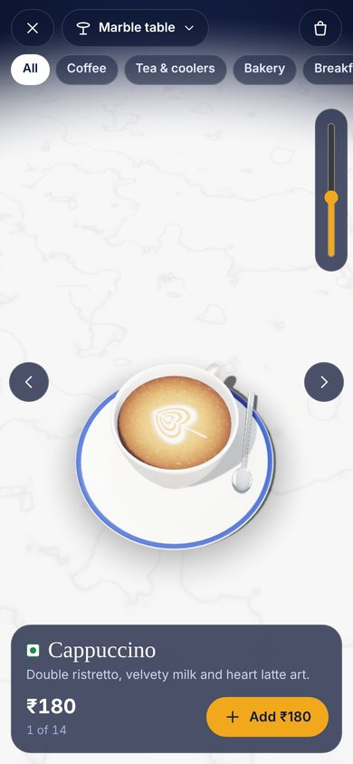
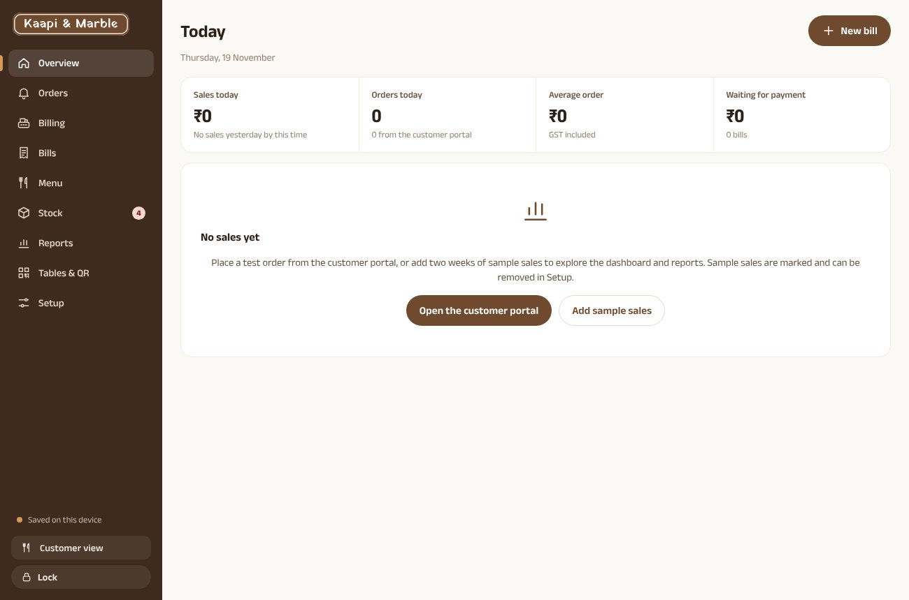
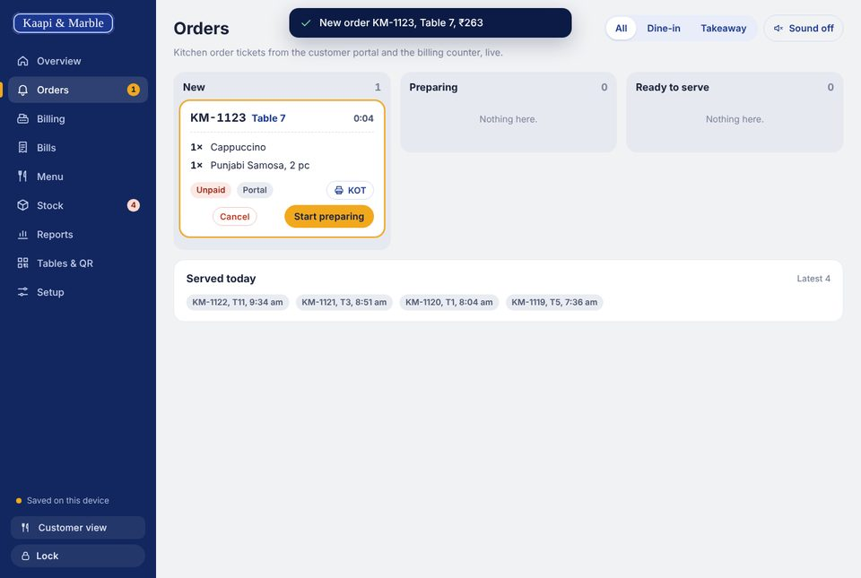

# Kaapi & Marble: café software with a 3D table menu

One web page, two apps:

- **Customer portal**: guests scan the QR on their table, see the menu, open the camera and swipe through dishes shown in 3D on their own table, order, and pay by UPI, card or at the counter. Bills show each order ID with the GST invoice.
- **Café manager**: kitchen order board, billing counter, bills, menu editor with 3D preview, recipe-based stock that deducts with every order, GST reports and printable table QR codes. Staff PIN: 1234.

 

## Quick start

```bash
node build.mjs        # builds dist/index.html
npx serve dist        # open http://localhost:3000
```

Open `#table-3` for the customer view or `#staff` for the café manager.

## Put it online

`dist/index.html` is the whole app. Upload it to any static host with HTTPS (Netlify, Vercel, Cloudflare Pages, GitHub Pages). HTTPS is required for the live camera; AR that pins dishes to the table works in Chrome on Android.

On its own the hosted page saves data in each browser. To share orders between guests' phones and the counter in real time, connect Supabase (below).

## Connect Supabase (live sync between phones, kitchen and counter)

1. Create a project at supabase.com. In **SQL editor**, run `supabase/schema.sql`.
2. Make the starter data and run it the same way:
   ```bash
   PORTAL_URL=https://your-cafe.example node tools/export-seed.js --sql   # writes supabase/seed.sql
   ```
3. **Authentication → Users → Add user** for the owner (email + password), copy its UUID, then run:
   ```sql
   insert into public.staff (user_id, name, role) values ('<uuid>', 'Owner', 'owner');
   ```
   Add cashiers and kitchen staff the same way.
4. Copy `config.example.json` to `config.json`, fill in the project URL and the **anon public** key (Project settings → API), then `node build.mjs`. Never put the service-role key in this file.
5. Deploy `dist/index.html` on HTTPS. The staff screen now asks for email and password instead of the PIN.

What the database enforces (row level security): guests can read the menu and stock, place new orders, take the next order number and mark their own order as paid or "I've paid" (UPI). Everything else needs a staff account. Customer names on orders are readable with the anon key, so ask for a first name only.

### Razorpay (card and UPI via gateway)

`supabase/functions/razorpay-webhook` verifies the `X-Razorpay-Signature` HMAC, checks the amount in paise and marks the order paid.

```bash
supabase functions deploy razorpay-webhook --no-verify-jwt
supabase secrets set RAZORPAY_WEBHOOK_SECRET=your_webhook_secret
```

In the Razorpay dashboard, add the webhook URL `https://<project>.supabase.co/functions/v1/razorpay-webhook` for `payment.captured`, and create each Razorpay order with `notes.order_id` set to the café order ID. The in-app card form stays in test mode until Checkout is wired in.

## Indian billing rules built in (checked November 2026)

- GST 5% without input tax credit for a standalone café; 18% with ITC only in "specified premises" (hotels with a room tariff above ₹7,500 a night). Switch in Setup.
- CGST = SGST = half the rate each, SAC 996331, FSSAI licence number and GSTIN on every bill, invoice numbers consecutive per financial year.
- No service charge, ever. The CCPA guidelines (upheld by the Delhi High Court in March 2025, with fines issued in 2026) forbid adding one by default or under another name.

## Test checklist

- [ ] `npm test` passes (GST math, stock, availability).
- [ ] Scan a table QR on a phone: the table number shows in the header.
- [ ] Veg-only filter, search and categories narrow the menu; a dish outside its hours shows "From 12 pm".
- [ ] Table view: camera opens on HTTPS; swipe changes dish; pinch resizes; photo and marble-table fallbacks work when the camera is blocked.
- [ ] Cart shows item total, CGST 2.5%, SGST 2.5%, round-off and total, with no service charge.
- [ ] Place an order on the phone: it appears on the kitchen board on another device within a second or two (Supabase) and the chime plays.
- [ ] Move it New → Preparing → Ready → Served; the guest's tracker follows.
- [ ] UPI: the QR opens a UPI app with the right amount; "I've paid" shows on the staff dashboard to confirm.
- [ ] Cancel an order: its ingredients return to stock.
- [ ] Use up an ingredient (stock count to 0): dishes that need it show "Sold out".
- [ ] POS bill with a 10% discount and cash: change is right, invoice prints with GSTIN, FSSAI and SAC.
- [ ] Two phones order at the same moment: order numbers are consecutive with no duplicates.
- [ ] Reports: GST summary taxable + CGST + SGST matches the bills; CSV export opens in a spreadsheet.

## Work on it with Claude Code

```bash
cd kaapi-marble-cafe
claude
```

Claude Code reads `CLAUDE.md` for the architecture, data model, billing rules and next steps.

## Screenshots

| | |
|---|---|
|  |  |
|  |  |
|  |  |
