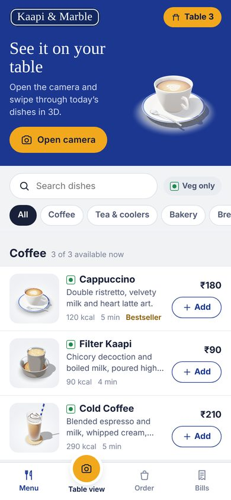
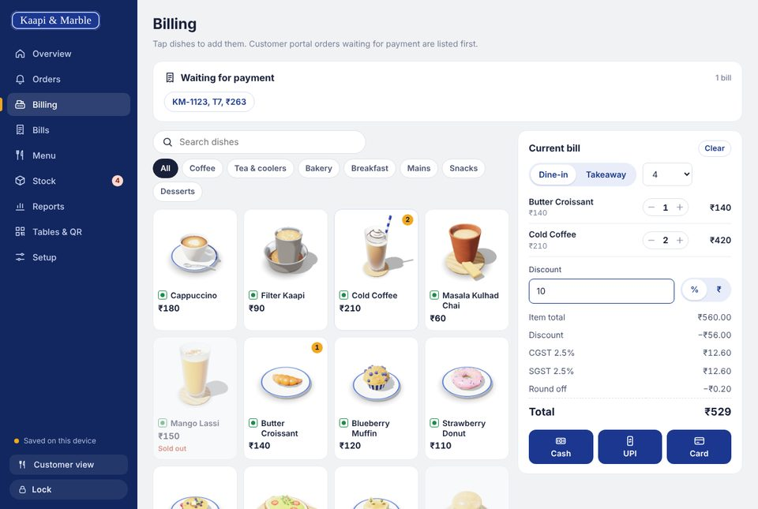

# Kaapi & Marble: café software with a 3D table menu

One web page, two apps:

- **Customer portal**: guests scan the QR on their table, see the menu, open the camera and swipe through dishes shown in 3D on their own table, order, and pay by UPI, card or at the counter. Bills show each order ID with the GST invoice.
- **Café manager**: kitchen order board, billing counter, bills, menu editor with 3D preview, recipe-based stock that deducts with every order, GST reports and printable table QR codes. Staff PIN: 1234.

 

## Quick start

```bash
node build.mjs        # builds dist/index.html
npx serve dist        # open http://localhost:3000
```

Open `#table-3` for the customer view or `#staff` for the café manager.

## Put it online

`dist/index.html` is the whole app. Upload it to any static host with HTTPS (Netlify, Vercel, Cloudflare Pages, GitHub Pages). HTTPS is required for the live camera; AR that pins dishes to the table works in Chrome on Android.

On its own the hosted page saves data in each browser. To share orders between guests' phones and the counter, connect a database. `CLAUDE.md` explains how.

## Work on it with Claude Code

```bash
cd kaapi-marble-cafe
claude
```

Claude Code reads `CLAUDE.md` for the architecture, data model, billing rules and next steps.

## Screenshots

| | |
|---|---|
|  |  |
|  |  |
|  |  |
