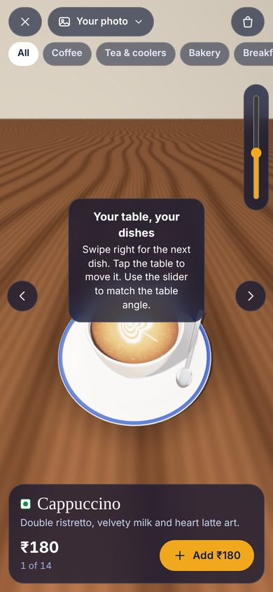
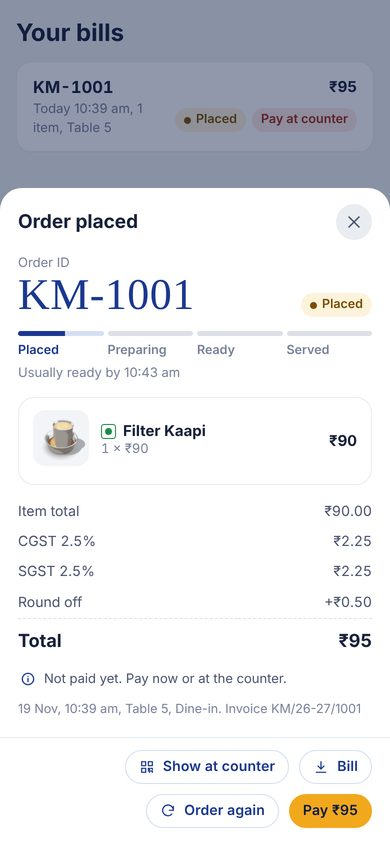
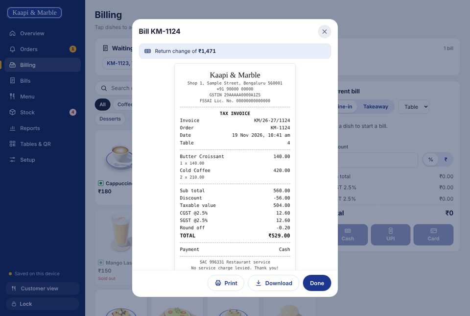
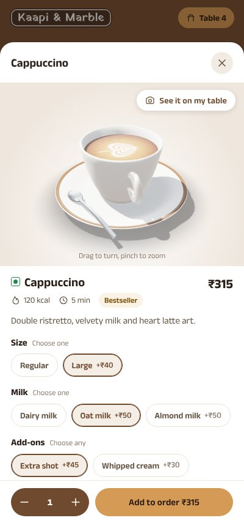
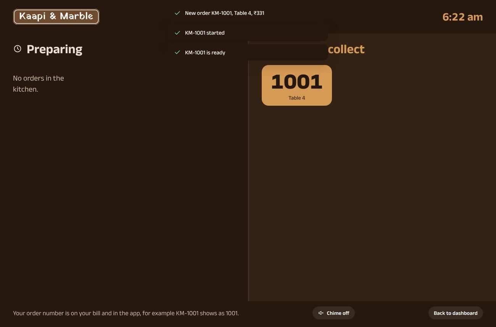
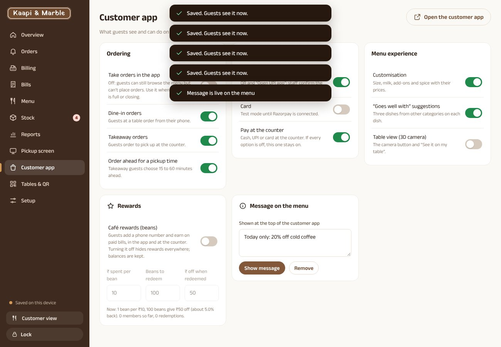
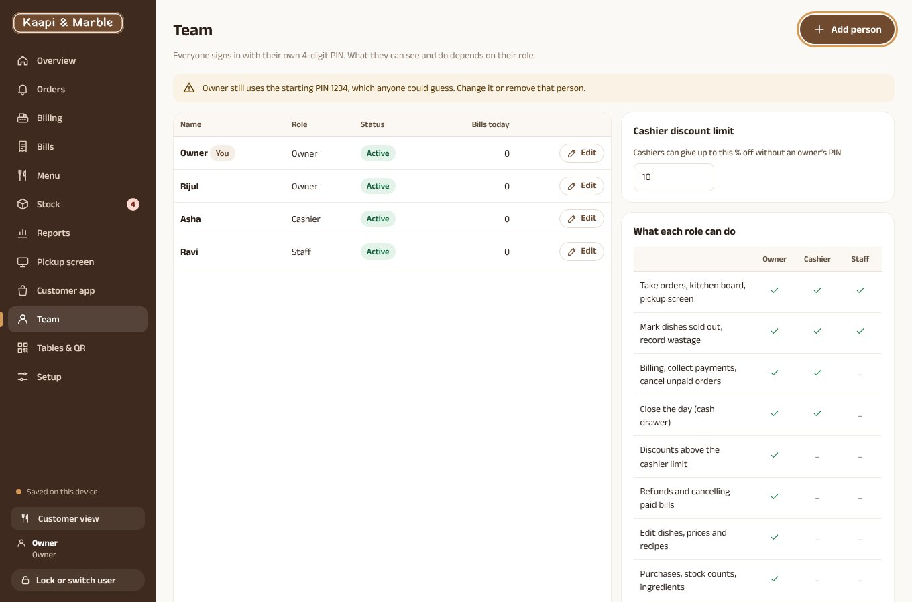
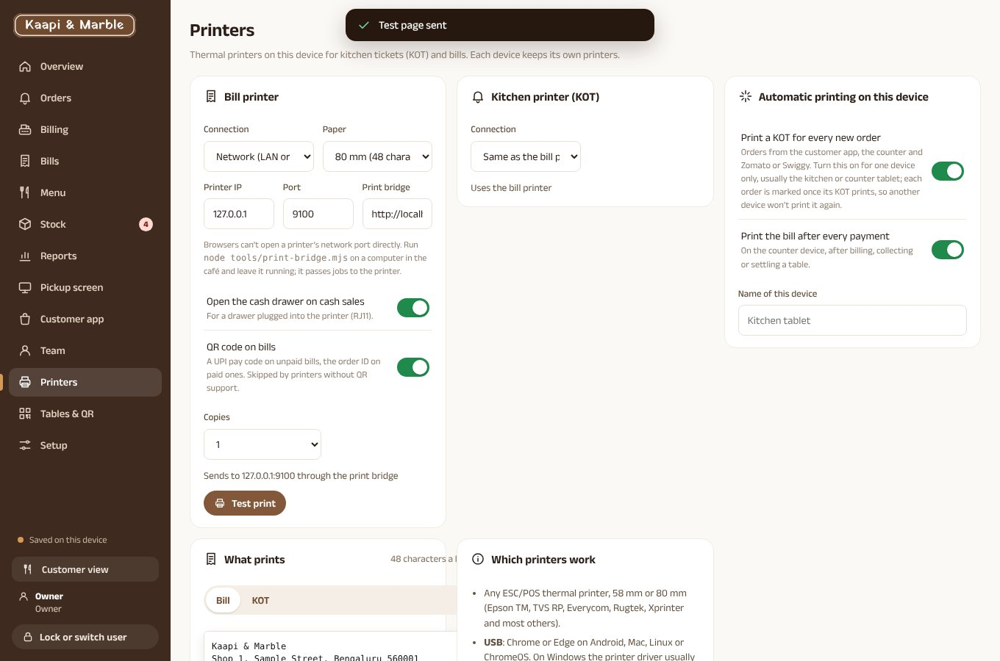
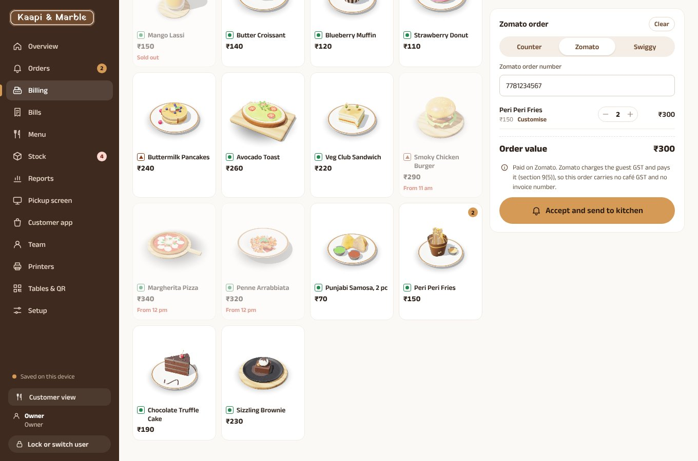

# Kaapi & Marble: café software with a 3D table menu

Two separate apps that share one database, so an order placed by a guest appears on the café dashboard straight away:

- **Customer portal**: guests scan the QR on their table, see the menu, open the camera and swipe through dishes shown in 3D on their own table, order, and pay by UPI, card or at the counter. Bills show each order ID with the GST invoice.
- **Café dashboard** (`cafe.html`): kitchen order board, pickup screen for a TV, billing counter, bills, menu editor with 3D preview, recipe-based stock that deducts with every order, GST reports and printable table QR codes. Staff sign in with their own PIN; the starting owner PIN is 1234.

The build makes three pages from the same source:

| Page | Who uses it | Opens with |
|---|---|---|
| `dist/index.html` | Guests (table QR codes point here) | `#table-3`, `#menu`, `#cart`, `#bills`, `#ar` |
| `dist/cafe.html` | Staff on the counter tablet, kitchen screen and TV | `#overview`, `#orders`, `#billing`, `#bills`, `#menu`, `#stock`, `#reports`, `#board`, `#tables`, `#setup` |
| `dist/demo.html` | Trying both in one tab | `#welcome`, `#table-3`, `#staff` |

## Features that chains use

- **Customise your order**: size, milk, extra shot, sweetness, spice and add-ons, each with its own price. Extra ingredients come off stock (a large latte uses more milk). Edit the choices per dish in Menu, or keep the defaults for its category.
- **Rewards**: guests add a phone number at checkout, earn 1 bean per ₹10 on paid bills and redeem 100 beans for ₹50 off. The discount is applied before GST. Balances are worked out from orders, so they never drift. Rates are in Setup.
- **Order ahead for pickup**: takeaway guests pick "as soon as ready" or in 15 to 60 minutes; the kitchen ticket shows the pickup time.
- **Pickup screen** (`cafe.html#board`): a TV view with "Preparing" and "Ready to collect" order numbers, a flash and an optional chime when an order turns ready.
- **Ready alerts on the guest's phone**: chime, vibration and a message when their order is ready.
- **Goes well with**: each dish suggests three dishes from other categories, one tap to add.
- **Kitchen time**: the dashboard shows the average minutes from order to ready today.

## Billing counter (POS)

- **Fast entry**: press `/` to search, type part of a name and press Enter to add the first match; Escape clears.
- **Customise lines**: each line has Customise (size, milk, add-ons) or Note; "+" repeats that exact line.
- **Send to kitchen, pay later**: dine-in tickets go to the kitchen board unpaid. When the table has several open bills, **Settle table** takes one payment for all of them.
- **Split payment**: any mix of cash, UPI and card; the last box fills itself, and reports count each part under its own method.
- **Rewards at the counter**: enter the guest's phone to earn beans, or redeem them for a discount before GST.
- **Digital bill**: send the full GST bill on WhatsApp (to the guest's number) or by email from the receipt or from Bills. The bill records that it was sent.
- **Close the day**: sales, discounts, CGST and SGST, payments by method, unpaid and cancelled bills, and the cash drawer (opening float + cash sales − cash refunds = expected, then count it to see over or short). Saved with a downloadable report.

## Thermal printers (`cafe.html#printers`)

Kitchen tickets (KOT) and bills print on ESC/POS thermal printers, 58 mm or 80 mm. Each device sets up its own bill printer and kitchen printer:

| Connection | Works in | Notes |
|---|---|---|
| USB | Chrome or Edge on Android, Mac, Linux, ChromeOS | WebUSB; on Windows the vendor driver usually holds the printer, so use Network or the print dialog |
| Bluetooth | Chrome on Android, Mac, Windows | Bluetooth LE printers; not on iPhone or iPad |
| Serial | Chrome or Edge on computers | USB-serial and RS-232 printers |
| Network (LAN / Wi-Fi) | Any device | Through the print bridge, below |
| Browser print dialog | Any browser | Prints the same 48 or 32 character layout |

- **Automatic printing**: one device (kitchen or counter) prints a KOT for every new order, from the customer app, the counter or Zomato/Swiggy. Each order is marked once its KOT prints, so a second device won't print it again. The counter device can print the bill after every payment and open the cash drawer on cash sales.
- **Network printers**: browsers can't open port 9100, so run the bridge on any always-on computer in the café: `node tools/print-bridge.mjs` (add `HOST=0.0.0.0` so tablets on the Wi-Fi can use it). It forwards only to private network addresses.
- Bills print GSTIN, FSSAI, invoice number, CGST/SGST, SAC and "No service charge"; a UPI QR prints on unpaid bills. `₹` prints as `Rs.` because thermal code pages don't have it.
- USB, Bluetooth and serial need HTTPS or localhost and Chrome/Edge. They don't work inside the Claude preview; use your own hosting.

## Zomato, Swiggy and ONDC orders

Online orders land in the same system as everything else: they appear on the kitchen board with a Zomato or Swiggy tag, print a KOT automatically, take stock off by recipe and show up in reports.

- **Typed in at the counter**: on Billing, switch "Counter" to Zomato or Swiggy, tap the dishes, enter the app's order number and press "Accept and send to kitchen".
- **Automatically**: Zomato and Swiggy send orders to POS systems through their integration partners (Zomato's POS developer platform, or middleware such as UrbanPiper). Point that partner's webhook at `supabase/functions/online-orders` (deploy steps in the file). It accepts a simple JSON format and UrbanPiper-style payloads, matches dishes by ID or name, ignores duplicates and inserts the order.
- **GST**: since 1 January 2022 the app charges and pays the 5% GST on restaurant orders it takes (section 9(5) of the CGST Act). So app orders carry no café CGST/SGST and take no number from the café's invoice series (their IDs look like `ZO-234567`). Reports and the GST CSV keep them apart from the café's own taxable value, listed as supplies through e-commerce operators. Check the return tables with your accountant.

Everyone signs in with their own 4-digit PIN (the first sign-in is the starting owner, PIN 1234; add your team and change it). The sidebar shows only what each role may use, and every bill, payment, cancellation and day close records who did it.

| | Owner | Cashier | Staff |
|---|:-:|:-:|:-:|
| Kitchen board, pickup screen, mark dishes sold out, record wastage | ✓ | ✓ | ✓ |
| Billing, collect payments, cancel unpaid orders, close the day | ✓ | ✓ | |
| Discounts above the cashier limit (10% by default) | ✓ | | |
| Refunds and cancelling paid bills | ✓ | | |
| Menu editing, purchases and stock counts, reports, customer app, team, setup | ✓ | | |

A cashier can still do an owner-only action once if an owner types their PIN on the same screen; the bill stores who approved it. Five wrong PINs lock the keypad for 30 seconds. PINs are stored as salted SHA-256 hashes, but a 4-digit PIN is a lock for a shared counter, not real security. With Supabase, staff sign in with email accounts, the role comes from the `staff` table, and the database lets only owners change settings, ingredients and the team.

## Customer app controls (`cafe.html#app`)

Staff switch the customer app live, without an update: app ordering on or paused, dine-in, takeaway, order ahead, UPI / card / pay at counter, customisation, "goes well with", the 3D table view, rewards on or off with their rates, and a message at the top of the menu.

 

## Quick start

```bash
node build.mjs        # builds dist/index.html
npx serve dist        # open http://localhost:3000
```

Open http://localhost:3000/#table-3 for the customer app and http://localhost:3000/cafe.html for the café dashboard. In one browser they share data through localStorage, so a guest order in one tab rings on the dashboard in the other. To sync different phones and the counter, connect Supabase (below).

## Put it online

Upload the `dist` folder (`index.html`, `cafe.html`) to any static host with HTTPS (Netlify, Vercel, Cloudflare Pages, GitHub Pages). HTTPS is required for the live camera; AR that pins dishes to the table works in Chrome on Android.

On its own the hosted page saves data in each browser. To share orders between guests' phones and the counter in real time, connect Supabase (below).

## Connect Supabase (live sync between phones, kitchen and counter)

1. Create a project at supabase.com. In **SQL editor**, run `supabase/schema.sql`.
2. Make the starter data and run it the same way:
   ```bash
   PORTAL_URL=https://your-cafe.example node tools/export-seed.js --sql   # writes supabase/seed.sql
   ```
3. **Authentication → Users → Add user** for the owner (email + password), copy its UUID, then run:
   ```sql
   insert into public.staff (user_id, name, role) values ('<uuid>', 'Owner', 'owner');
   ```
   Add cashiers and kitchen staff the same way.
4. Copy `config.example.json` to `config.json`, fill in the project URL and the **anon public** key (Project settings → API), then `node build.mjs`. Never put the service-role key in this file.
5. Deploy `dist/index.html` on HTTPS. The staff screen now asks for email and password instead of the PIN.

What the database enforces (row level security): guests can read the menu and stock, place new orders, take the next order number and mark their own order as paid or "I've paid" (UPI). Everything else needs a staff account. Customer names on orders are readable with the anon key, so ask for a first name only.

### Razorpay (card and UPI via gateway)

`supabase/functions/razorpay-webhook` verifies the `X-Razorpay-Signature` HMAC, checks the amount in paise and marks the order paid.

```bash
supabase functions deploy razorpay-webhook --no-verify-jwt
supabase secrets set RAZORPAY_WEBHOOK_SECRET=your_webhook_secret
```

In the Razorpay dashboard, add the webhook URL `https://<project>.supabase.co/functions/v1/razorpay-webhook` for `payment.captured`, and create each Razorpay order with `notes.order_id` set to the café order ID. The in-app card form stays in test mode until Checkout is wired in.

## Indian billing rules built in (checked November 2026)

- GST 5% without input tax credit for a standalone café; 18% with ITC only in "specified premises" (hotels with a room tariff above ₹7,500 a night). Switch in Setup.
- CGST = SGST = half the rate each, SAC 996331, FSSAI licence number and GSTIN on every bill, invoice numbers consecutive per financial year.
- No service charge, ever. The CCPA guidelines (upheld by the Delhi High Court in March 2025, with fines issued in 2026) forbid adding one by default or under another name.

## Test checklist

- [ ] `npm test` passes (GST math, stock, availability).
- [ ] Scan a table QR on a phone: the table number shows in the header.
- [ ] Veg-only filter, search and categories narrow the menu; a dish outside its hours shows "From 12 pm".
- [ ] Table view: camera opens on HTTPS; swipe changes dish; pinch resizes; photo and marble-table fallbacks work when the camera is blocked.
- [ ] Cart shows item total, CGST 2.5%, SGST 2.5%, round-off and total, with no service charge.
- [ ] Place an order on the phone: it appears on the kitchen board on another device within a second or two (Supabase) and the chime plays.
- [ ] Move it New → Preparing → Ready → Served; the guest's tracker follows.
- [ ] UPI: the QR opens a UPI app with the right amount; "I've paid" shows on the staff dashboard to confirm.
- [ ] Cancel an order: its ingredients return to stock.
- [ ] Use up an ingredient (stock count to 0): dishes that need it show "Sold out".
- [ ] POS bill with a 10% discount and cash: change is right, invoice prints with GSTIN, FSSAI and SAC.
- [ ] Customise a cappuccino (Large, oat milk, extra shot): price adds ₹135 and the kitchen ticket lists the choices.
- [ ] Add a phone number, pay; after staff mark it paid, the beans balance goes up. Redeem 100 beans: ₹50 comes off before GST.
- [ ] Takeaway in 30 min: the ticket shows the pickup time; mark it ready and the number flashes on `cafe.html#board`.
- [ ] POS: send two dine-in tickets for Table 5, then Settle table with ₹300 cash + the rest on UPI; Reports split the amounts by method.
- [ ] Receipt: WhatsApp opens a chat to the guest's number with the full GST bill.
- [ ] Close the day: expected cash = float + cash sales − cash refunds; counting less shows "Short by".
- [ ] Customer app page: pause ordering and turn off the table view; the guest's phone shows the notice, hides the camera and blocks Place order straight away.
- [ ] Team: add a cashier and a staff member. The cashier can't open Reports or Setup; a 25% discount asks for an owner PIN and the bill shows who approved it. Staff see only Orders, Menu, Stock and the pickup screen.
- [ ] Printers: choose Network, enter the printer IP, run the print bridge, Test print. Turn on automatic KOTs: a guest order prints its KOT without a tap; a cash sale prints the bill and opens the drawer.
- [ ] Zomato order typed in at Billing: shows on the kitchen board with a Zomato tag, prints a KOT, has no CGST/SGST, and Reports lists it under ordering apps.
- [ ] Two phones order at the same moment: order numbers are consecutive with no duplicates.
- [ ] Reports: GST summary taxable + CGST + SGST matches the bills; CSV export opens in a spreadsheet.

## Work on it with Claude Code

```bash
cd kaapi-marble-cafe
claude
```

Claude Code reads `CLAUDE.md` for the architecture, data model, billing rules and next steps.

## Screenshots

| | |
|---|---|
|  |  |
|  |  |
|  |  |
|  |  |
|  |  |
|  |  |
